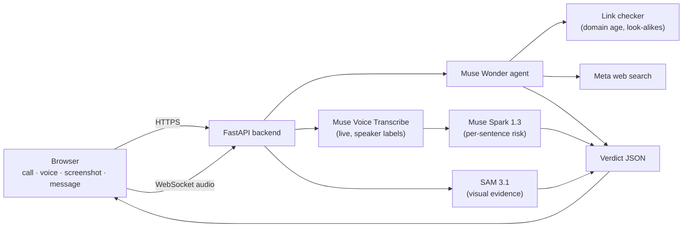

# 🛡️ Sentinel

**A second opinion before you pay, click or share.**

Sentinel checks anything that feels like a scam (a live phone call, a voice note, a screenshot or a message) and tells people, in their own language, exactly what to do.

🔗 **Live app:** https://sentinel-x9xf.onrender.com
🎬 **Demo video:** _coming soon_

> The free hosting tier sleeps when idle, so the first visit can take about 30 seconds to wake up.

---

## The problem

Every day, people lose their savings to "digital arrest" calls, fake KYC messages and voice-cloned "relatives" asking for urgent money. Victims are rarely careless. They are scared, rushed, and often hearing the scam in a language and tone designed to make them panic. The people most targeted, such as older family members, often don't read English comfortably.

Sentinel is built for that moment: something feels wrong, and you need a calm, clear answer in seconds.

---

## What Sentinel does

| Feature | What it does |
|---|---|
| 📞 **Live call protection** | Listens to a call on speaker, separates the two speakers, labels the likely scammer and escalates its warning as the call unfolds. When the user is about to pay or share an OTP, the whole screen turns red with a specific warning, spoken aloud, with a vibration on Android. |
| 🎙️ **Voice note check** | Upload any recording (including WhatsApp voice notes) or record in the browser. Sentinel flags scam tactics and gives a separate verdict on whether the voice sounds real or AI-cloned. |
| 🖼️ **Screenshot check** | Draws numbered boxes on the exact spots where the fraud is: the phishing link, the sender, a uniform badge in a fake video call. |
| 💬 **Message and link check** | Paste text or drop a screenshot. An agent checks every link and phone number and searches for scam reports before giving a verdict. |
| 🌍 **English and Hindi** | The whole interface and every answer switch language in one tap. The analysis itself works across many languages, including Hinglish, Tamil and Spanish. |

Every verdict comes with **what to do now**, **why**, the **exact quoted evidence**, and **what Sentinel checked**.

---

## Built on Meta's models

| Model | Role in Sentinel |
|---|---|
| **Muse Wonder** | The core agent. Reads messages and screenshots, listens to voice notes, decides when to call tools, and writes the final verdict. Also locates text evidence on screenshots and judges whether a voice sounds AI-generated. |
| **Muse Spark 1.3** | Fast analysis of every sentence during a live call. |
| **Muse Voice Transcribe** | Live and recorded transcription with speaker separation (diarization). |
| **SAM 3.1** | Precise boxes around faces, badges and logos as visual evidence. |
| **Muse Image** | Generated synthetic test images (fictional brands only) for safe evaluation. |
| **Meta web search tool** | Lets the agent verify claims, official websites and scam reports. |

---

## How it works



- **Messages, screenshots and voice notes** go to a Muse Wonder agent that investigates with tools (a link checker and web search) before answering. Verdicts are grounded in what the tools found.
- **Live calls** stream 24 kHz audio from the browser over a WebSocket. Muse Voice Transcribe returns each finished sentence with a speaker label, Muse Spark 1.3 re-scores the conversation, and the browser shows escalating alerts and the STOP takeover.
- **Screenshot evidence:** Muse Wonder names and roughly locates each suspicious region. For objects (faces, badges, logos), SAM 3.1 finds the exact box, and only matches that overlap Muse Wonder's estimate are kept.

---

## Evaluation

Tested on a **65-case, hand-built multilingual set** (English, Hindi, Hinglish, Spanish, Tamil) using the real product path, including **30 deliberately hard cases**: polite scams with no links, and genuine messages that look alarming (declined-card alerts, e-challans, KYC reminders, missed-delivery notices).

| Metric | Result |
|---|---|
| Scams flagged | **38 / 38** |
| False alarms on genuine messages | **0 / 27** |
| Firm SCAM verdict on scams | 36 / 38 (2 subtle cases rated SUSPICIOUS, "verify first") |
| Average time per check | ~14 s (includes link checks and web search) |

This is a small set we wrote ourselves, so treat it as evidence of careful behaviour on realistic cases, not as a real-world accuracy figure. Run it yourself with `python -m eval.run_eval`.

---

## Run it locally

```bash
git clone https://github.com/Kritank07/Sentinel.git
cd Sentinel
python -m venv venv
# Windows: .\venv\Scripts\Activate.ps1   |   macOS/Linux: source venv/bin/activate
pip install -r requirements.txt
```

Create a `.env` file with your Meta Model API key:

```
MODEL_API_KEY=your_key_here
```

Start the server and open http://127.0.0.1:8000:

```bash
uvicorn app:app --reload
```

---

## Project structure

```
app.py               FastAPI server: API endpoints, live-call WebSocket, rate limiting
sentinel/
  engine.py          Prompts and the Muse Wonder agent loop
  tools.py           Link checker tool (risky domains, look-alikes, domain age)
  segment.py         SAM 3.1 boxes + evidence matching
  asr.py             Recording transcription with speaker labels
  live.py            Live call session (Muse Voice Transcribe + Muse Spark)
web/                 The web app (home, call, voice, screenshot, message pages)
eval/                Test cases and evaluation runner
render.yaml          Render deployment config
```

---

## Privacy and safety

- Sentinel's server does not store the messages, screenshots or recordings people check. They are sent to Meta's Model API for analysis, so Meta's API terms apply (on free credits, Meta may use content for product improvement). Avoid submitting other people's private information.
- Visitor analytics (GoatCounter) count page views only, with no cookies, and never see what people check.
- Per-visitor rate limits protect the service from abuse.
- Verdicts quote their evidence, and Sentinel is honest about uncertainty: a voice check is presented as one clue, not proof.

## Limitations

- The evaluation set is small and hand-built.
- Voice-deepfake detection is a signal, not proof; new cloning tools can sound very real.
- Live protection needs the Sentinel page open with the call on speaker. Vibration works on Android, not iPhone.
- Sentinel gives safety guidance, not legal or financial advice.

---

**Lost money to a scam in India?** Call **1930** or report at **cybercrime.gov.in**.

Built by **Kritank Jain**.
